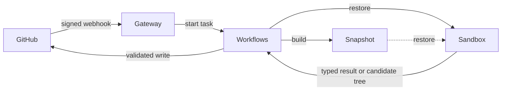

# Architecture

Agents inspect and modify repositories inside short-lived Render Sandboxes.
Code in the Workflows service validates their results and performs every
GitHub write.

## System



The Blueprint deploys two services:

- **Gateway** verifies webhooks and maps each delivery to one task.
- **Workflows** runs tasks, manages Sandboxes, and writes to GitHub.

The application does not implement its own queue, dispatcher, heartbeat
process, background maintenance loop, or database.

## Workflow

```text
issue --factory:triage--> specification
specification --factory:spec-approved--> draft pull request
pull request --factory:pr-review--> COMMENT review
```

### Triage

Triage reads the issue discussion and the base branch. The triage agent asks
up to five questions, declines the request, or sends it to the spec-writing
agent. The spec-writing agent produces a bounded specification. Questions and
specifications are GitHub comments with hidden markers.

### Spec-to-PR

Spec-to-PR confirms that the approved specification has not changed. It
implements that specification in a Sandbox, runs the configured verification
commands, allows a bounded number of repairs, and opens a draft pull request
on `factory/issue-<number>`.

### PR Reviewer

PR Reviewer checks out the labeled pull request commit, runs the configured
verification commands, and posts one COMMENT review. The review covers
security, correctness, performance, and tests.

### Autopilot

Applying `factory:autopilot` grants upfront approval for Triage, Spec-to-PR, and PR Reviewer.
The parent starts each GitHub task with `ctx.run`, so every stage has its own compute, claim,
status, and Sandbox.

Autopilot does not apply the manual transition labels. Triage can still remove
a stale `factory:spec-approved` label when it revises a spec. Triage returns
the exact App-authored spec comment and content hash to Spec-to-PR, which
verifies that the current spec still matches. Spec-to-PR returns the pull
request number and head commit directly to PR Reviewer. If Triage asks
questions, the parent adds `factory:autopilot` back before it ends; a human
reply starts a new parent run. At other times the trigger label is absent, so
unrelated comments do not restart the workflow.

## State

Each system owns the state it already manages:

| State | Owner |
|---|---|
| Task status, timing, input, and result | Render Workflows |
| Issues, labels, specifications, pull requests, and reviews | GitHub |
| Current run and Sandbox for an issue or pull request | App-authored status comment |
| Prepared repository filesystem | Render Sandbox snapshot |
| Run and agent outcomes, usage, and cost | JSON lines in Workflows logs |

Telemetry is not application state. Nothing reads log events to decide what a
task may do.

## Coordination

Webhook delivery is not exactly once. GitHub can redeliver events, and people
can apply labels or post comments at the same time. The factory handles this
at three boundaries:

1. The GitHub delivery ID becomes the Workflows idempotency key.
2. The status comment names the run that holds the claim on an issue or pull
   request.
3. Hidden markers identify App-authored specifications, pull requests, and
   reviews so writes can update or reuse them.

For a composed workflow, the status marker records both the root workflow run
and the current child task. Cancellation stops the root; the child ID still
identifies the current stage and Sandbox.

A new GitHub task run cancels the run named in the status comment, terminates
its recorded Sandbox, and writes its own run ID to the comment. The run whose
write remains visible holds the claim. Other runs stop when they next check
the comment.

GitHub tasks check ownership before progress updates and durable writes.
Publishing also uses a deterministic branch and refuses to overwrite human
commits.

This design keeps coordination beside the GitHub object it controls. Adding a
database would create a second owner for the same claim.

## Sandboxes and snapshots

A base-branch push builds a repository snapshot with the runner, a base
checkout, and installed dependencies. A GitHub task then:

1. restores the newest snapshot;
2. replaces the snapshot's runner bundle with this deployment's when their
   hashes differ, root-owned and read-only to the runner user;
3. verifies runtime permissions and process hardening;
4. fetches the exact requested ref with a temporary read-only token;
5. removes the token and verifies its removal;
6. reinstalls dependencies when the lockfiles or install command changed;
7. runs agents and repository commands as an unprivileged user; and
8. closes the Sandbox in `finally`.

Render terminates a cancelled task without running `finally`. For that case,
each GitHub task records its Sandbox ID in the status comment. A replacement
run or `/factory cancel` terminates the recorded Sandbox. The provider timeout
is the final cleanup backstop.

Snapshots avoid reinstalling dependencies on every run. Restored Sandboxes
still fetch the requested commit and verify their current state; a snapshot is
prepared state, not trusted current state.

## Agents

An agent definition fixes:

- its prompt;
- its harness: the agent library and model that run it;
- available tools;
- output schema;
- turn limit; and
- stable ID.

The model loop and every model-directed tool run in the Sandbox beside the
checkout. Agent tools never run on the Workflows host.

A harness adapter in `app/harness/` wraps an agent library's own
configuration. Agent definitions and their harnesses are bundled into the
Sandbox runner, which runs the agent named in its input on that agent's
harness. The host and the runner speak a versioned contract
(`app/runner/core/protocol.ts`): JSON on stdin, with the key on the first line,
and JSON Lines events on stdout. Every harness gives the model the factory's
own tools and `submit`, so tool authority and the read-only shell policy don't
depend on the library. In the runner, a kernel owns each run: its events, turn
and time limits, tools, and submission. A harness's driver only translates its
library.

Every agent finishes through a typed `submit` tool. The runner validates the
submission against JSON Schema. The host validates it again with the agent's
Zod schema. Repositories, refs, issue numbers, pull requests, branches, and
write targets come from authenticated task input, never model output.

## Publishing

The Sandbox has no GitHub write credential. It returns a candidate tree to
the Workflows host, which:

1. collects changes through a throwaway Git directory;
2. validates paths, modes, file counts, sizes, and blob hashes;
3. rejects workflow files, symlinks, and submodules;
4. asks GitHub to build the same tree;
5. compares GitHub's tree SHA with the Sandbox tree SHA; and
6. moves the deterministic branch only when the factory still owns it.

## Trust boundaries

Issue text, comments, source files, dependency scripts, and pull request diffs
are untrusted.

### Gateway

The gateway verifies the webhook signature before parsing the body. It holds
no GitHub credential and runs no model or repository code.

### Workflows host

The Workflows service holds GitHub and Render credentials. It selects every
destination, checks claim ownership, validates Sandbox output, and performs
GitHub writes.

### Sandbox

Clone and fetch credentials are read-only and temporary. Runtime files are
root-owned and read-only. Agents and repository commands run as an
unprivileged user.

Every Sandbox is created with an HTTPS egress allow-list built by the
Workflows host from trusted configuration. Task Sandboxes reach `github.com`,
the agents' model APIs, and the repository's configured `egress` hosts. The
snapshot builder reaches `github.com`, Debian's package mirror, and the
repository's hosts. Render enforces the list outside the Sandbox and fixes it
at creation, so nothing inside the Sandbox can widen it. See
[Sandbox egress](configuration.md#sandbox-egress).

The model key enters the Sandbox during an agent call. The runner receives it
through a root-only path and stdin, removes provider keys from tool
environments, and runs under a non-dumpable Node binary. These controls and
the allow-list reduce exposure; they do not make untrusted code safe.

## Security invariants

Changes must preserve these properties:

1. Verify a webhook signature before parsing its body.
2. Check the triggering actor's current repository permission for every
   GitHub task run.
3. Let only code in the Workflows service write to GitHub.
4. Keep GitHub write credentials out of Sandboxes.
5. Run every model-directed tool inside a Sandbox.
6. Build repositories, refs, branches, and write targets from trusted input.
7. Publish only after GitHub reproduces the validated tree SHA.
8. Stop automation at a draft pull request and a COMMENT review.
9. Implement the specification as it existed when approved.
10. Give every Sandbox a provider timeout and `finally` cleanup. Record a
    GitHub task's Sandbox so cancellation can terminate it.
11. Create every Sandbox with an egress allow-list built from trusted
    configuration. Only a repository's configured `egress: "allow-all"` lifts it.

Tests pin these invariants and the tool authority of every built-in agent.

## Residual risks

- Allowed hosts remain exfiltration paths. Code in a Sandbox can send data to
  an attacker's own GitHub account or model API account through `github.com`
  or the model API, and to anything a wildcard rule admits. Task Sandboxes
  keep `github.com` for their whole lifetime because the policy can't change
  after the fetch.
- DNS resolution is not restricted by the allow-list.
- A repository configured with `egress: "allow-all"` has unrestricted egress.
- The model key exists in runner memory during a call.
- Prompt injection can influence specifications, code, and reviews.
- Anyone with `minimumPermission` can start model spend.
- PR Reviewer runs repository-defined commands from the labeled pull request.
- The Render API key may have workspace-wide authority.
- Near-simultaneous triggers can both work until one loses the status-comment
  claim.
- Workflows inputs and results are visible to people with service access.
- Telemetry can include repository names, issue subjects, and errors that
  quote repository output.
- The filesystem of each deployed Render service is ephemeral. Durable state
  belongs in GitHub, Workflows, or Sandbox snapshots.
- A cancelled snapshot build can leave its builder Sandbox running until the
  one-hour provider timeout because builders are not recorded in a status
  comment.

Use a dedicated Render workspace and a spend-capped model key when stronger
isolation matters.

Expected work failures produce a useful status-comment result. Unexpected
platform or programming failures fail the Workflows task and require
operator investigation.

## Code map

Start with:

1. [`app/gateway/routes.ts`](../app/gateway/routes.ts) — webhook-to-task
   routing.
2. [`app/workflows/github-task.ts`](../app/workflows/github-task.ts) —
   GitHub task declaration.
3. [`app/claims/claim.ts`](../app/claims/claim.ts) — permission, ownership,
   progress, and completion.
4. [`app/workflows/triage/index.ts`](../app/workflows/triage/index.ts) — one
   complete GitHub task.
5. [`app/workflows/autopilot/index.ts`](../app/workflows/autopilot/index.ts) —
   parent/subtask orchestration.
6. [`app/agents/run.ts`](../app/agents/run.ts) — host-side agent execution.
7. [`app/runner/main.ts`](../app/runner/main.ts) — Sandbox runner entry point;
   [`app/harness/`](../app/harness/) — agent library adapters.
8. [`app/sandbox/sandbox.ts`](../app/sandbox/sandbox.ts) — Sandbox lifecycle.
9. [`app/changeset/index.ts`](../app/changeset/index.ts) — validated
   publishing.

Use the [extension runbook](runbooks/extend.md) to add agents, tasks, or
triggers.

## Maintenance extension

The fork adds two plain tasks: `verify-repository` and `maintenance-sweep`.
They operate on operator-selected exact commits using deployed recipes and
make no issue/PR claims or model calls. The dispatcher resolves configured
repositories and submits a bounded sweep; children run sequentially.

Fresh verification shares the existing bootstrap and credential scrub path,
but does not restore dependency snapshots. It runs repository commands as the
unprivileged user, then publishes a completed Check only after sandbox cleanup
has been attempted. GitHub App write credentials remain on the host.

Workflows retains the returned health report; GitHub Checks provide the commit
view. The provider timeout covers hard cancellation, and results distinguish
unconfirmed cleanup. There is no persistent scheduler ledger, global lock, or
notification service. See [maintenance](maintenance.md) for operation and limits.

### Dependency scan and selected verification

`dependency-scan` refreshes advisory and version evidence and reports an urgency
based on known severity and direct fix metadata. It never reports application
verification or writes to GitHub. `dependency-scan-sweep` retains compact results
in urgency order. Neither task is a persistent queue or a human review record.

Public/PAT scans can reuse credential-free filesystem snapshots. The cache
validates the exact source revision, recipe/tool identity, runtime and dependency
inventory, and a bounded lifetime. App-mode scans bypass this cache because their
checkout preparation can stage a GitHub credential. Cache state is an execution
optimization and cannot authorize publishing.

`dependency-verify-selected` loads a completed scan from the same Workflow,
validates freshness and current source/configuration, and starts a normal
`dependency-review` for the exact selected candidate. That review independently
rediscovers the candidate and runs clean baseline and candidate verification.
Publishing still requires that review's retained evidence and its existing gates.
See [dependency scanning](dependency-scanning.md) for operation and limitations.

### PAT maintenance boundary

The standalone maintenance entrypoint registers only the maintenance tasks.
An explicitly configured `MAINTENANCE_GITHUB_TOKEN` selects controller-side PAT
API calls and commit-status publication. Public-repository metadata is validated
before sandbox creation; cloning is anonymous, with no credential staging.
Private repositories are rejected in this mode. App-based maintenance retains
repository-scoped read-only clone tokens and Check Runs. PAT mode does not change
the inherited agent workflows' authentication or publishing authority.

### External maintenance history

The optional catalog adapter replaces maintenance coverage with an approved execution
export owned by `render-registry-catalog`. The bundled registry consumer validates
identity and policy; factory validation still checks supported install recipes and
sandbox egress. Discovery and preview exports do not authorize execution.

Scheduled dispatchers can retain completed scan/review results through DX 360's
authenticated ingestion API. DX 360 owns the append-only Postgres history. Records
include the catalog and check identities, exact source/candidate, normalized
observations, full native evidence and the reviewed target configuration. This is new
retained-history state; GitHub claim ownership and Render task execution stay with
their existing owners. The factory has no database credential.

DX archives each approved execution bundle once, keyed by content digest and bound
to its approved Workflow. Runs reference that immutable bundle. Ingestion validates
against the originating bundle even after the deployed catalog changes; it cannot
approve caller-supplied bundles. Historical validity does not imply current freshness
or authorize execution under an old policy.

Producer plus observation ID is immutable. Baseline and candidate observations are
separate even within one Workflow run. A successful scan can contain high-severity
findings; its completion is never converted into passing application verification.
The receiver authenticates before parsing, bounds payload size, validates the catalog
contract and input/evidence identity, and rejects conflicting retries. Browser history
reads remain behind DX 360's existing session middleware. Only the exact ingestion
path bypasses session auth and enforces its own machine credential.

Receipt failure is visible and recoverable by child run ID. No automatic retry of
sandbox side effects is added. Activation requires a clean catalog execution export,
DX 360's migration/API deployment, and matching configuration on both sides; the
current live schedules continue without this optional integration until configured.
